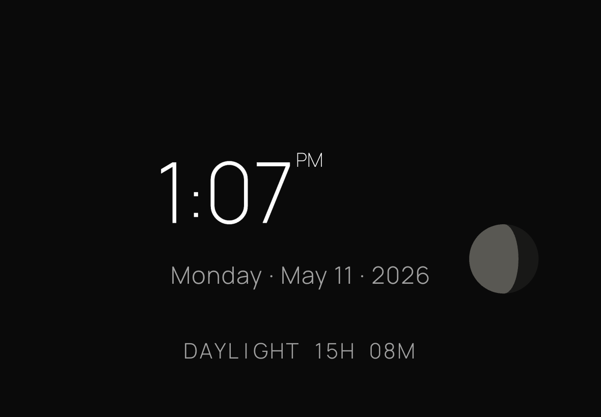
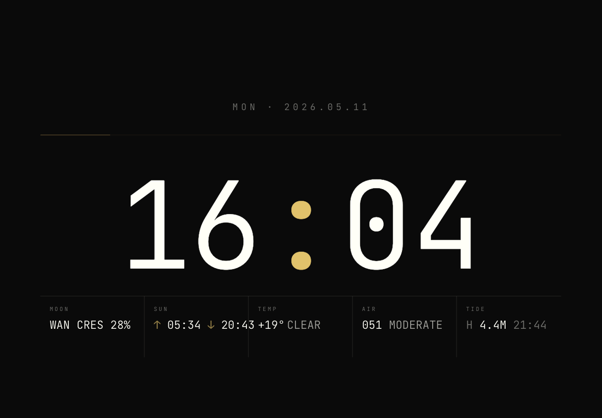
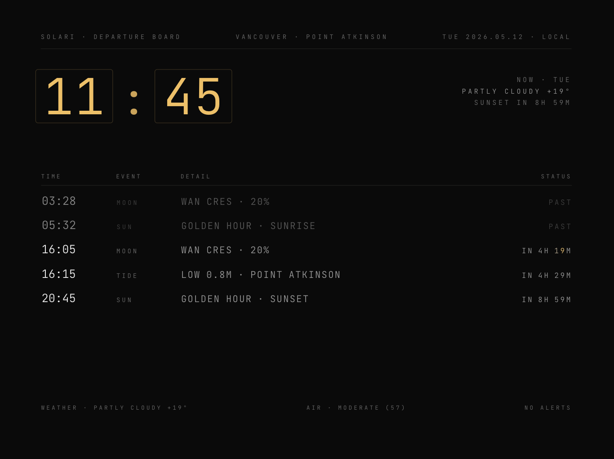
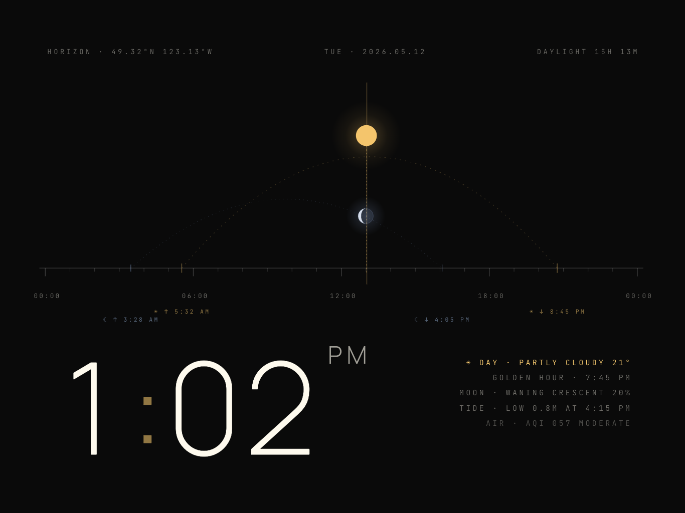

# Solari

An ambient display for iPad, showing time, weather, tides, moon phase, and astronomical events for Vancouver, BC.

Solari is a beautiful object first, a quiet sense of rhythm second, a source of facts third. It runs 24/7 in a living room, never demanding attention. Named after the Solari split-flap departure boards -- the kinetic split-flap transitions are the signature detail.

Live: [joshuascottpaul.github.io/solari](https://joshuascottpaul.github.io/solari/)

## What it shows

- Time and date
- Current weather and temperature
- Air quality index (AQI)
- Tide times (Point Atkinson, DFO)
- Moon phase disc
- Astronomical events: sunrise, sunset, civil twilight, golden hour
- Upcoming almanac events: meteor showers, eclipses
- Holiday and custom observances

## Key features

- 4 clockfaces shipped (Calm, Mechanical, Departures, Horizon); Editorial coming soon
- Split-flap kinetic transitions on rotating content slots
- Sky-colored typography that shifts with sun altitude, weather, and observances
- 8-layer burn-in protection: Perlin drift, pixel-shift, kinetic churn, macro position shifts, sky-color modulation, luminance breath, daily 03:00 refresher cycle, and rendering hygiene
- Perlin-noise drift with coprime periods keeps every element in slow, independent motion

## Faces

V1 ships four faces. Each is a distinct visual voice on the same underlying data engine. Editorial is coming soon.

### Calm

The default. Manrope 200 time at 165 px, single rotating slot, moon disc bottom-right. Quiet, centered, minimal.



### Mechanical

JetBrains Mono 300 tabular numerals at 236 px with gold colon, five-column complications grid (MOON / SUN / TEMP / AIR / TIDE) at the bottom, minute-arc hairline at the top.



### Departures

The Solari namesake. Split-flap board with gold-bezel hour-minute flap pair, five rotating event rows (sun/tide/moon/almanac), per-character cascade animation on row updates, header strip and footer chrome.



### Editorial (coming soon)

Magazine-cover composition. Large italic time on the left, mirrored right-column kicker and date block, rotating literary almanac paragraph that cross-fades every 32 seconds. Layout flips every 6 hours. The face code is present but the webfont is not yet loaded; the current build renders with a Georgia fallback. A polished release is planned for V2.

### Horizon

Astronomy as truth. Full-stage SVG diagram with sun and moon arcs, 25 hour ticks, phase-correct moon crescent, dipping behind the horizon line at rise and set. Each body trails a fading elapsed arc from its rise point to its current position. Gold hairline cursor sweeps left-to-right over 24 hours. Big time in the bottom corner, status block right.



## Changing faces

### Open the picker

Three ways to reach the picker:

| Method | How |
|---|---|
| Long-press (iPad) | Hold the time numerals or moon disc for 600 ms |
| Direct URL | Navigate to `https://joshuascottpaul.github.io/solari/clockface.html` |
| localStorage (advanced) | Open DevTools console and run `localStorage.setItem('solari.clockface', 'mechanical')` then reload |

A short single tap on the moon disc or time numerals opens the version overlay instead. Hold longer (600 ms) for the picker.

Valid face IDs for the localStorage method: `calm`, `mechanical`, `departures`, `editorial`, `horizon`. (`editorial` renders with a Georgia fallback in the current release; the webfont ships in V2.)

### Using the picker

Scroll vertically through the five face cards. The toolbar at the bottom shows the face name and a counter.

Tap the Tweaks button (bottom-right) to open the tweaks panel:

| Tweak | Options |
|---|---|
| Accent color | gold, sky, sage, paper |
| Drift intensity | off, subtle, normal, restless |
| Mechanical: time format | 12h, 24h |
| Horizon: time format | 12h, 24h |
| Departures: bezel opacity | slider, 0.0 to 0.4 |

Tap Apply (gold button) to save. The main display reloads automatically within 2.4 seconds and a toast confirms the change.

On desktop you can navigate with ArrowUp / ArrowDown, j / k, or PageUp / PageDown. Escape closes the tweaks panel.

### Face shuffle (advanced)

Add `?shuffle=weekday` or `?shuffle=random` to the URL to enable automatic face selection on each boot or 03:00 soft reload.

- `weekday` maps each day of the week to a face (Sun/Sat=Calm, Mon/Thu=Mechanical, Tue/Fri=Departures, Wed=Horizon).
- `random` picks from the four faces, excluding the previous pick.

The URL parameter is saved to `localStorage.solari.shuffle` and persists across boots. A manual picker Apply overrides the next shuffle for six hours so deliberate picks survive the day's 03:00 reload. Editorial is excluded from both pools in V1.

To disable shuffle, run `localStorage.removeItem('solari.shuffle')` in DevTools and reload.

### First-run defaults

On first visit, localStorage is empty. The display defaults to Calm with gold accent and normal drift intensity.

## Technology

Vanilla HTML, CSS, and JavaScript. No framework, no build step, no API keys. Total size: approximately 228 KB uncompressed. Deployed as static files via GitHub Pages.

Vendored libraries in `lib/` (both MIT-licensed): SunCalc for astronomical calculations, Perlin for noise generation.

External data comes from free public APIs: Open-Meteo (weather, AQI), DFO IWLS (tides), Environment Canada (weather alerts). Open-Meteo is fetched live in the browser. The DFO and Environment Canada feeds do not send CORS headers, so the browser cannot read them directly; both fall back to static files in `data/`.

### Tide data pipeline

Because the browser cannot reach DFO IWLS directly, tides use a small server-side refresh loop instead of a live fetch:

1. A GitHub Actions workflow (`.github/workflows/refresh-tides.yml`) runs every Monday at 06:00 UTC on GitHub's runners, where CORS does not apply.
2. It fetches 90 days of high/low predictions for Point Atkinson from the DFO IWLS API and writes them to `data/tides.json`.
3. It commits the file only when the data actually changed; an unchanged fetch (or an API error) is a clean no-op that leaves the last good data in place.
4. The always-on display just reads the committed `data/tides.json` as a static file. There is no backend and no API key; the workflow is the only thing that talks to DFO.

**Keepalive.** GitHub disables scheduled workflows after 60 days with no commit, and only a commit resets that timer (tags, releases, and merged PRs do not count). Since the tide fetch usually no-ops, it cannot keep itself alive during quiet periods. A final keepalive step handles this: when the repo has been quiet for 30+ days it pushes a single empty commit (`[skip ci]`) to reset the timer, and stays dormant the rest of the time. It is implemented inline rather than via the popular `keepalive-workflow` action, which GitHub has since blocked for a terms-of-service violation. No external monitoring is needed: GitHub emails the repo owner about both an impending auto-disable and any failed run.

## Run locally

```
python3 -m http.server 8000
```

Open `http://localhost:8000` in a browser. Use Safari on iPad for final verification.

## Deploy

Push to `master`. GitHub Pages serves the files directly -- no build step required.

## iPad setup

1. Open `https://joshuascottpaul.github.io/solari/` in Safari.
2. Tap Share, then Add to Home Screen.
3. Open the app from the home screen (enables full-screen, hides browser chrome).
4. Plug in the iPad and set it in a fixed landscape position.

### Recommended settings

| Setting | Value |
|---|---|
| Auto-Lock | Never |
| Auto-Brightness | On |
| Reduce White Point | On, approximately 25% |
| True Tone | On |
| Display brightness | 40-60% |

### Monthly maintenance

Power-cycle the iPad for 30 minutes once a month to allow full thermal rest.

## Getting updates

A single tap on the moon disc (Calm) or the time numerals (Mechanical) shows the version overlay: build hash and deploy date.

When a new version is live on GitHub Pages, the overlay shows "UPDATE AVAILABLE · TAP TO RELOAD". Tap it to force-fetch fresh files. This is the recommended way to update a running iPad install.

To inspect captured JavaScript errors, tap the moon disc or time numerals to show the version chip, then long-press the chip for 600 ms. The chip expands into a scrollable log of the last 50 captured errors. Tap anywhere outside to close. This is a developer diagnostic, not a user-facing feature.

### Service worker caching

On first visit, all assets are cached for offline use. Subsequent visits may be served from the cache until the version overlay detects a new commit. If you need to force a fresh load during development:

- Safari: Develop menu, Empty Caches, then reload
- Chrome: DevTools, right-click the reload button, Empty Cache and Hard Reload

## Sleep and wake

The clock self-corrects after the iPad wakes from sleep. The rotator resumes where it left off. All burn-in protection layers (drift, macro shifts, luminance breath) resume automatically. No manual intervention is needed.

## Configuration

Edit the `CONFIG` object at the top of `app.js`. Key options:

| Key | Default | Description |
|---|---|---|
| `display.timeFormat` | `'12h'` | `'12h'` or `'24h'` |
| `display.showSeconds` | `false` | Show seconds in time display |
| `observances.customObservances` | `[]` | Add custom dates with name, glyph, palette, and treatment |
| `refresher.enabled` | `true` | Enable daily 03:00 burn-in refresher |
| `luminanceBreath.enabled` | `true` | Enable 30-minute luminance oscillation |

To add a custom observance, uncomment and edit the example entry in `CONFIG.observances.customObservances`.

## License

Source code is MIT-licensed. Vendored libraries (`lib/suncalc.js`, `lib/perlin.js`) are also MIT-licensed.
